  

  
  
  

## About

I'm a penetration tester and security engineer with 4+ years of hands-on experience running internal and external assessments across web applications, mobile apps, enterprise networks and Active Directory, including sensitive government-related and enterprise systems.

I find the path an attacker would take, prove it works, and write it up so engineers can fix it and leadership understands the risk. Then I re-test to confirm the fix holds. Before security I was a full-stack developer (Node.js, Angular, SQL Server), which still shapes how I read the systems I test.

## What I test

| Area | Focus | Tooling |
|:--|:--|:--|
| **Web apps & APIs** | OWASP Top 10 and beyond, REST APIs, auth and input handling | `Burp Suite` `SQLMap` |
| **Mobile** | Android penetration tests, plus iOS engagements | `jadx` `Frida` `Ghidra` |
| **Networks** | Internal and external segments and infrastructure | `Nmap` `Nessus` `Wireshark` `Metasploit` |
| **Active Directory** | Misconfigurations, credential exposure, privilege escalation paths | `BloodHound` `CrackMapExec` `Impacket` |
| **Attack simulation** | Phishing, credential harvesting, privilege escalation | `Metasploit` `Impacket` |
| **Secure code review** | Exploitable flaws and insecure patterns in source | `Java` `Python` `C#` |

## How I work

- **Every finding is validated.** If it's in the report, there's a working proof of concept behind it.
- **Reports for two readers.** Reproduction steps and remediation for the engineer who fixes it; risk ratings and attack scenarios for the executive who funds it.
- **Fixes are verified.** I re-test remediated issues, so a finding closes only when the risk is gone.

## Career

  

| When | Role | Where |
|:--|:--|:--|
| 2024 – now | **Security Engineer** | Keepa, Shiraz |
| 2022 – 2023 | **Penetration Tester** (team's mobile tester) | Spara Security Group, Tehran |
| 2021 – 2022 | **Junior Penetration Tester** (intern) | Faraz Pajohan, Tehran |
| 2019 – 2020 | **Full-Stack Developer** (intern) | Aren |

## Toolbox

| Category | Tools |
|:--|:--|
| **Offensive** | `Burp Suite` `Nmap` `Metasploit` `Nessus` `Wireshark` `SQLMap` `BloodHound` `CrackMapExec` `Impacket` |
| **Mobile & RE** | `jadx` `Frida` `Ghidra` |
| **Platforms** | `Wazuh` `Ojuri` (customized and run in production) |
| **Tech** | `Linux` `Windows` `Active Directory` `TCP/IP` `DNS` `HTTP/S` `REST APIs` `Python` |
| **Standards** | `OWASP Top 10` `Secure configuration review` `Remediation validation` |

## Credentials

- **Web Hacking Expert**, Ravin, 2023
- **OWASP Top 10 Web Application Vulnerabilities**, Ravin, 2022
- **LPIC-303 · LPIC-2 · LPIC-1**, Linux Enterprise Professional, Anisa, 2021–2022
- **B.S. Computer Engineering**, Shiraz University, in progress

## Current focus

Internal security automation, bug bounty workflows and advanced Active Directory attack paths. I take part in bug bounty and responsible disclosure programs and do independent research in web and network security.

Client engagements stay confidential, so you won't find client findings here. Public write-ups and lab walkthroughs will land in this account as they're ready.

---

  Open to penetration testing, offensive security, red team and application security roles · remote or relocation 
  <a href="https://sherwin.rocks">sherwin.rocks</a> · <a href="https://www.linkedin.com/in/sherwin-enayati/">LinkedIn</a> · <a href="mailto:sherwin.enayati@gmail.com">sherwin.enayati@gmail.com</a>

